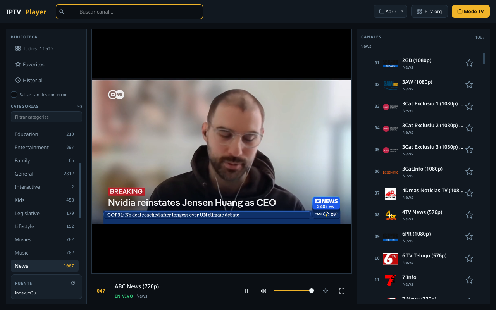
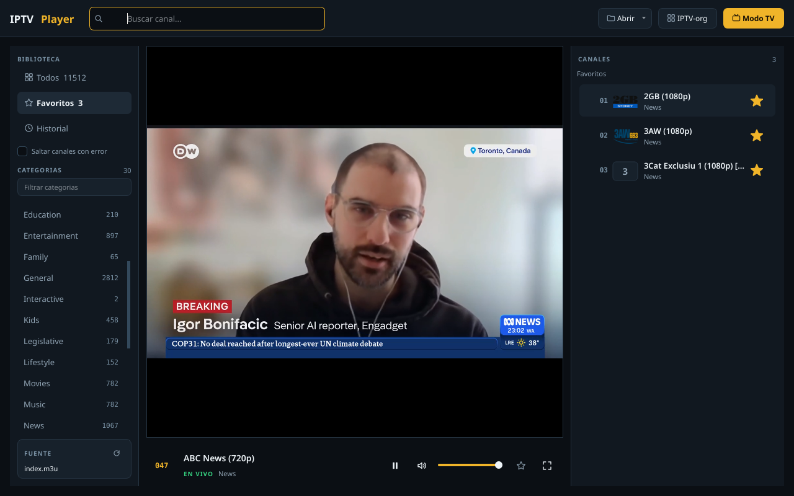
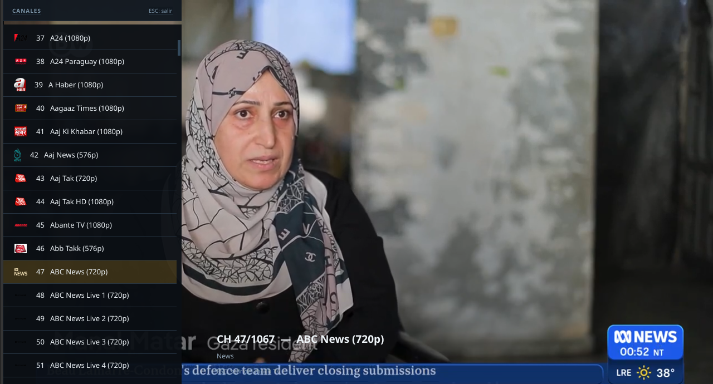
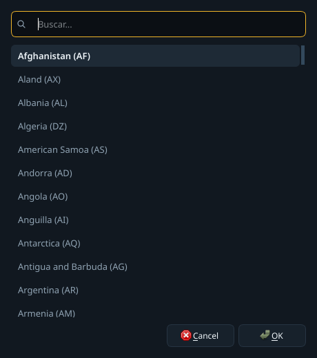

# IPTV Player

Reproductor de IPTV de escritorio con PySide6 y mpv. Catalogo publico de
[iptv-org](https://github.com/iptv-org/iptv), busqueda global, favoritos
persistentes y un modo TV pensado para usarse con teclado.

[](https://github.com/hmoreirar/iptv-player-python/actions/workflows/tests.yml)
[](LICENSE)
[](https://www.python.org/)



## Que es

Una app de escritorio para ver canales publicos de TV sin abrir el navegador.
Carga playlists M3U locales o remotas, usa iptv-org como catalogo por defecto y
reproduce dentro de la misma ventana con mpv embebido.

El problema interesante no es descargar una lista: es navegar **11.512 canales**
sin que la interfaz se vuelva inutil. La app prioriza encontrar, cambiar y
guardar canales en segundos.

## Features

- Playlist predeterminada de iptv-org con mas de 11.000 canales.
- Selector por pais, categoria o idioma desde la API de iptv-org.
- Cache local de 24 h con fallback offline si falla la red.
- Parser M3U con URLs relativas, multiples categorias y headers HTTP por canal.
- Busqueda global con debounce sobre toda la biblioteca.
- Categorias con contador y filtro propio.
- Favoritos persistidos por canal completo: nombre, URL, logo, grupo y headers.
- Modo TV a pantalla completa con sidebar, banner, entrada numerica y zapping.
- Saltar automaticamente canales caidos en Modo TV.
- Logos cargados solo para las filas visibles.
- Tema oscuro propio, iconos SVG y sin emojis.
- Lanzador `.desktop` incluido.

## Capturas

| Principal | Favoritos |
|---|---|
|  |  |

| Modo TV | Selector IPTV-org |
|---|---|
|  |  |

## Stack

- **Python 3.10+**
- **PySide6 / Qt 6** para la interfaz.
- **mpv / libmpv** para reproduccion embebida.
- **requests** para playlists y metadatos.
- **pytest** para tests.
- **PyInstaller** para empaquetado.

Diseno y decisiones visuales: [DESIGN.md](DESIGN.md).

## Instalacion

### Dependencias del sistema

Ubuntu / Debian:

```bash
sudo apt update
sudo apt install -y mpv libmpv2 python3-dev python3-venv
```

Fedora:

```bash
sudo dnf install -y mpv mpv-libs python3-devel
```

macOS:

```bash
brew install mpv
```

Windows: instalar [mpv](https://mpv.io/installation/) y agregarlo al `PATH`.
La interfaz y el empaquetado estan pensados principalmente para Linux.

### Desde el codigo

```bash
git clone https://github.com/hmoreirar/iptv-player-python.git
cd iptv-player-python
python3 -m venv .venv
source .venv/bin/activate
pip install -r requirements.txt
python -m app.main
```

### Lanzador en el menu

Con el venv creado:

```bash
./scripts/install_desktop.sh
```

Crea `~/.local/share/applications/iptv-player.desktop` y el icono en
`~/.local/share/icons/hicolor/scalable/apps/`. Busca **IPTV Player** en el menu.
Si mueves el proyecto, vuelve a ejecutar el script.

### AppImage

La release incluye una AppImage para Linux x86_64. Requiere `libmpv.so.2`
instalado en el sistema (`libmpv2` en Debian/Ubuntu). La AppImage no incluye
libmpv para evitar redistribuir una libreria GPL.

```bash
chmod +x IPTV-Player-1.0.0-x86_64.AppImage
./IPTV-Player-1.0.0-x86_64.AppImage
```

## Uso

1. Al arrancar se carga iptv-org desde cache o red.
2. La vista inicial muestra **News**; **Todos** abre el catalogo completo.
3. **IPTV-org** permite elegir pais, categoria o idioma.
4. La busqueda recorre toda la biblioteca, no solo la categoria activa.
5. La estrella de cada fila, el boton de la barra Ahora, clic derecho o `F`
   guardan un favorito.
6. **Modo TV** oculta la interfaz y deja solo video, sidebar y banner.

### Atajos

| Tecla | Accion |
|---|---|
| `Space` | Reproducir / pausar |
| `M` | Silenciar |
| `F` | Guardar / quitar favorito |
| `F11` | Pantalla completa |
| `Ctrl+F` o `/` | Enfocar busqueda |
| `Escape` | Salir de pantalla completa o Modo TV |

### Modo TV

| Tecla | Accion |
|---|---|
| Flecha arriba / abajo | Canal anterior / siguiente |
| Flecha izquierda / derecha | Volumen |
| `0-9` | Numero de canal |
| `Enter` | Confirmar numero / mostrar guia |
| `Backspace` | Canal anterior |
| `Tab` | Mostrar / ocultar sidebar |
| `M` | Silenciar |
| `F` | Guardar / quitar favorito |
| `Escape` | Salir |

## Arquitectura

```text
app/
  main.py              ventana, navegacion, reproduccion y persistencia
  tv_mode.py           overlay de Modo TV (banner + sidebar)
  favorites.py         store de favoritos por canal completo
  ui/
    theme.py           tokens y QSS global
    icons.py           iconos SVG propios
    widgets.py         lista de canales, categorias y barra Ahora
  m3u/
    parser.py          parser M3U + headers + multi-categoria
    loader.py          carga en hilo con cache y fallback offline
    cache.py           cache local de playlists y metadatos
    iptv_org.py        URLs, API y selector de iptv-org
  player/
    mpv_player.py      wrapper de libmpv
```

Decisiones tecnicas:

- La carga de playlist corre en `QThread`; la UI no se bloquea.
- `QSettings` persiste volumen, geometria, historial, favoritos y preferencias.
- Los favoritos guardan el canal completo, no solo la URL: sobreviven a cambios
  de playlist y a la rotacion de streams de iptv-org.
- Los logos se piden solo para filas visibles y se comparten por URL.
- mpv se inicializa despues de `showEvent` y usa `vo=xv` con `xcb` para
  embeber video en X11/XWayland.
- El parser conserva `tvg-id`, `http-user-agent`, `http-referrer` y `#EXTHTTP`.

## Tests

```bash
pip install -r requirements-dev.txt
pytest tests/ -q
ruff check app tests --select E,F --ignore E402,E501
```

Cubren parser M3U, headers, categorias multiples, cache/metadatos, favoritos,
migracion de favoritos viejos y persistencia. La reproduccion real no corre en
CI porque necesita un display y `libmpv`.

## Empaquetado

```bash
pip install -r requirements-dev.txt
pyinstaller iptv-player.spec --noconfirm
```

Build de AppImage:

```bash
./scripts/build_appimage.sh
```

El resultado queda en `dist/`.

## Limitaciones

- iptv-org solo enlaza streams publicos de terceros. No se aloja video.
- Muchos canales estan caidos, geo-bloqueados o cambian de URL.
- La app depende de `mpv`/`libmpv` instalado en el sistema.
- Usa `vo=xv` y `QT_QPA_PLATFORM=xcb`: funciona en X11/XWayland, no en Wayland
  puro.
- Sin EPG, grabacion ni cuentas de usuario.

## Roadmap

- Guia de programacion (EPG).
- Filtro por pais/idioma dentro de la biblioteca ya cargada.
- Orden configurable y busqueda por voz.
- Release firmada y paquete `.deb`.
- Tests de UI con Qt y un stream local de prueba.

## Creditos

- Canales y metadatos: [iptv-org](https://github.com/iptv-org/iptv).
- Reproduccion: [mpv](https://mpv.io/) y
  [python-mpv](https://github.com/jaseg/python-mpv).
- Interfaz: Qt 6 y PySide6.

Avisos de licencias de terceros: [THIRD_PARTY_NOTICES.md](THIRD_PARTY_NOTICES.md).

## Licencia

MIT. Ver [LICENSE](LICENSE).
