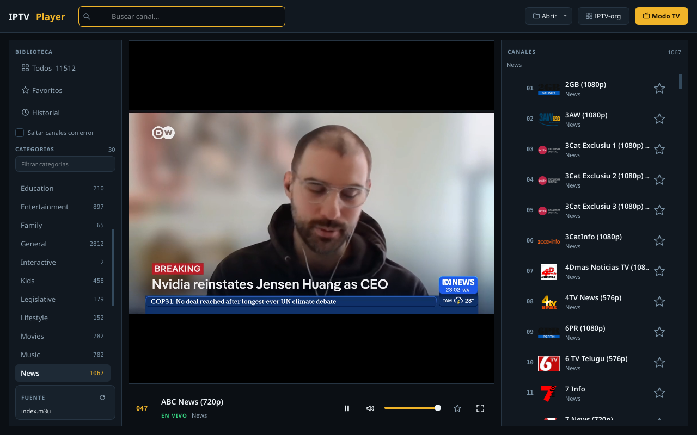
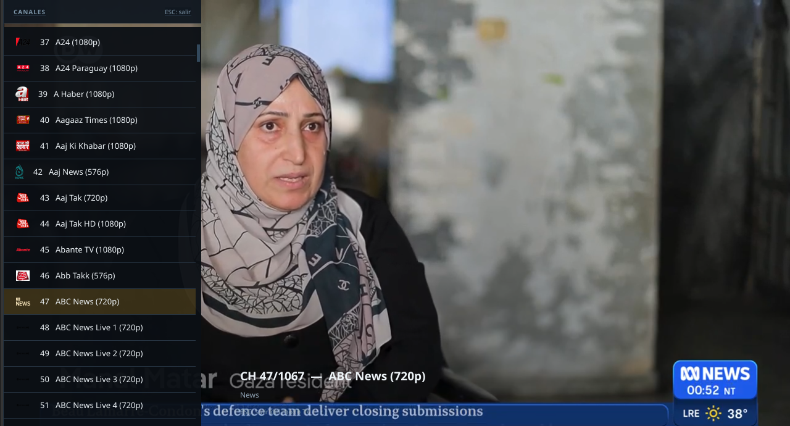

# Caso de estudio: IPTV Player

## Contexto

IPTV Player es una app de escritorio Linux para ver canales publicos de TV.
Nacio como un reproductor M3U pequeno y termino siendo un ejercicio de diseno de
producto: como hacer usable un catalogo de **11.512 canales** sin convertir la
interfaz en una lista infinita.

- Rol: diseno de producto, UI y desarrollo.
- Stack: Python, PySide6/Qt 6, libmpv, requests.
- Estado: v1.0.0, codigo abierto bajo MIT.



## El problema

Las playlists publicas de iptv-org son enormes y cambian todos los dias. Una
lista plana de 11.000 canales falla en tres frentes:

1. **Encontrar**: el usuario no sabe donde esta un canal ni que categorias
   existen.
2. **Cambiar**: el zapping con teclado sobre miles de filas es insufrible.
3. **Volver**: los favoritos guardados por URL se rompen cuando iptv-org rota
   el stream.

El reto no era agregar mas funciones, sino reducir el tiempo entre "quiero ver
noticias" y "estoy viendo noticias".

## Decisiones de producto

- **Catalogo por defecto, no configuracion inicial**: la app arranca con
  iptv-org y cache local. Cero friccion para el primer canal.
- **Busqueda global**: buscar ignora la categoria activa. Si el usuario escribe
  "BBC", no deberia importar en que categoria estaba.
- **Categorias con contador**: `News 1067` comunica tamano y ayuda a decidir.
  Ademas, las categorias multiples de iptv-org (`Animation;Kids;Religious`) se
  separan para que el filtro sea real.
- **Favoritos por canal completo**: nombre, URL, logo, grupo y headers. El
  favorito sigue existiendo aunque la playlist actual no lo contenga.
- **Vista inicial acotada**: con listas grandes se abre una categoria (News), no
  "Todos". El catalogo completo sigue a un clic.
- **Modo TV como modo real**: no es fullscreen del reproductor; tiene sidebar,
  banner, entrada numerica, volumen y salto de canales caidos.

## Decision de diseno

Direccion: **consola de emision nocturna**.

El producto se usa de noche, con el video de fondo. La interfaz no compite con
la imagen: fondo tinta, superficies grafito y una sola senal ambar para el canal
actual y los favoritos. El verde queda reservado para `EN VIVO`; el rojo, para
errores. No hay sombras, glass ni gradientes: la jerarquia se construye con
capas tonales, lineas de 1 px, densidad y numeros tabulares.

Tres decisiones concretas:

- Panel de canales fijo a la derecha, no una lista debajo del video. El zapping
  y la lectura de nombres ganan espacio vertical.
- Filas de 56 px con numero monoespaciado, logo, nombre, grupo y estrella. La
  fila actual se marca con fondo y `EN VIVO`, no con una barra lateral.
- Barra "Ahora" con el canal, controles y favorito; un toast arriba para
  confirmaciones, sin tapar controles.

Ver [DESIGN.md](../DESIGN.md) para tokens, tipografia y componentes.



## Arquitectura

```text
QMainWindow
  ├─ TopBar            marca, busqueda, Abrir, IPTV-org, Modo TV
  ├─ Sidebar           biblioteca, categorias, fuente y refresh
  ├─ Center            video embebido + NowPlayingBar
  └─ ChannelPanel      lista virtualizada visualmente con delegate
```

Piezas clave:

- **PlaylistLoader (QThread)**: descarga o lee cache y parsea fuera del hilo de
  UI. Cache TTL 24 h con fallback a copia local.
- **Parser M3U**: headers por canal (`http-user-agent`, `http-referrer`,
  `#EXTVLCOPT`, `#EXTHTTP`), URLs relativas, `tvg-id` y categorias multiples.
- **FavoritesStore**: JSON en `QSettings`; migra la lista vieja de URLs y
  resuelve por `tvg-id` o URL.
- **ChannelDelegate**: pinta fila, logo, grupo, estado vivo y estrella sin crear
  widgets por canal.
- **TVMode**: banner y sidebar en ventanas overlay para convivir con el video
  nativo de mpv.

## Retos tecnicos

### Embeber mpv en Qt

Wayland y XWayland complicaron el embedding. La solucion estable fue forzar
`QT_QPA_PLATFORM=xcb`, usar `WA_NativeWindow`, inicializar mpv despues de
`showEvent` y elegir `vo=xv`. Tambien hay que fijar `LC_NUMERIC=C` antes de
crear la instancia de libmpv.

### Overlays sobre video nativo

Los overlays del Modo TV son ventanas `Qt.Tool` sin marco, posicionadas sobre el
video. Asi el sidebar y el banner se dibujan por encima del video nativo de mpv
en X11.

### Escala

- Se cargan logos solo de las filas visibles y se comparte una descarga por URL.
- La busqueda tiene debounce de 180 ms.
- La lista usa un delegate de pintura, no widgets por fila.
- La cache evita descargar 2.5 MB en cada arranque.

### Favoritos que no se rompen

Guardar solo la URL era fragil: iptv-org rota streams. El store guarda el canal
completo y migra automaticamente el formato anterior. Si el canal sigue en la
playlist actual, se enriquece con la version vigente; si no, se muestra igual.

## Resultados

- 11.512 canales en la playlist completa, 30 categorias reales.
- Carga desde cache en menos de 1 segundo.
- 44 tests: parser, headers, categorias multiples, metadatos, favoritos,
  migracion y persistencia.
- Interfaz completa sin emojis, con iconos SVG propios.
- Lanzador de escritorio y AppImage para Linux.

## Que mejoraria

- EPG para mostrar "que esta pasando ahora".
- Filtro por pais e idioma dentro de la biblioteca cargada.
- Tests de UI automatizados con un stream local.
- Paquete `.deb` y AppImage firmada.
- Deteccion de canales caidos en segundo plano para marcar disponibilidad.

## Enlaces

- Repo: https://github.com/hmoreirar/iptv-player-python
- Release: https://github.com/hmoreirar/iptv-player-python/releases
- Diseno: [DESIGN.md](../DESIGN.md)
- Producto: [PRODUCT.md](../PRODUCT.md)
